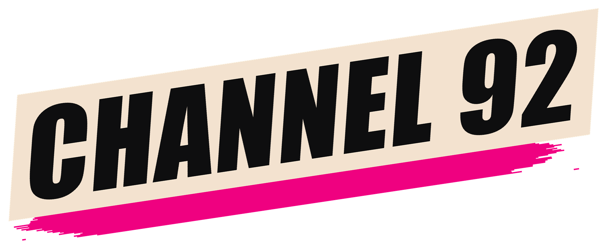

<p align="center">
  
</p>

# Channel 92: a free kit for cinematic music films

A free, open (MIT), mostly local AI kit for turning a finished song into a cinematic film. It starts from the song:
it times every sung line, finds the beats and the bar's one, and maps the song's shape (verses, choruses, the long
instrumental breaks where pictures have to carry the story), so a film's story is planned on that timeline. Then it
plans cuts on the bar, writes the prompts, drives ComfyUI graphs on your own GPUs for the renders and Blender for sets
and passes, places each render back on the song by its sound, and assembles, grades and checks the cut. Stems, stills
and renders stay on your machine. Every stage reads and writes plain JSON in the project folder, so a person can stop,
look, edit and go on, and a person decides at six gates (concept, the song by ear, the look, the board, the render
time, the cut) and nowhere else.

Made for the films of Channel 92, a fictional television channel that broadcasts from 1950 to 2010. Films made for
the channel keep its logo in the top right corner (`finish` puts it on) and may open with its intro (film.json
`brand.intro`). Before anything is generated the director chooses the film's aspect (16:9, 4:3, 2.39:1 or 9:16) and
may set its year on the channel, 1950 to 2010 (`choose`). The command is `channel92`; `atomic-flix` is the same
command under its first name, and the docs' examples use it. The Python package is still `atomic_flix` and every
file's format tag still reads `atomic-flix/...`, so films made before the rename open unchanged.

The models the graphs load are open-weight and have their own licences; films made with them should say what is
AI-made.

Status (2026-11-19): Phase 1 integrated and graded. One command, `channel92` (or `atomic-flix`), drives a film from
stems to a graded, flash-checked and reviewed cut; `docs/quickstart.md` walks a whole film on a synthetic song with no GPU, and
`tools/replay_first_film.py` replays our first film through the kit on the CPU. The ComfyUI runner is being tested
against a real ComfyUI; the scenes stage needs Blender 5.2 for its renders. Clean-room status: `docs/clean-room.md`,
`PROVENANCE.md`, `docs/shared-vocabulary.md`.

## Install

Python 3.10 or newer; numpy is the only runtime dependency. ffmpeg and ffprobe on the PATH for anything with video.
Blender only for `scenes capture` and `scenes blend`. [ntsc-rs](https://github.com/ntsc-rs/ntsc-rs/releases) only for
the eras' analog looks in `finish`.

```
python -m venv .venv
.venv\Scripts\python -m pip install -e ".[dev]"      (Windows)
.venv/bin/python -m pip install -e ".[dev]"          (Linux, macOS)
channel92 setup                                      (checks every prerequisite; says how to get what is missing)
channel92 setup --install                            (fetches the pinned ntsc-rs after you type yes)
.venv\Scripts\python -m pytest                       (the fast suite)
.venv\Scripts\python -m pytest -m first_film         (the first film's regressions: set FLIX_FIRST_FILM)
.venv\Scripts\python -m pytest --cov               (with coverage)
.venv\Scripts\python -m build --wheel              (a wheel in dist/; `build` comes with the dev extra)
```

`channel92 setup` only checks: Python, numpy, ffmpeg, ffprobe and ntsc-rs are required (it exits non-zero while one
is missing), Blender, a ComfyUI host and Pillow are optional. `channel92 setup --install` fetches the one program the
kit can fetch itself, ntsc-rs v0.9.7's standalone build for Windows or Linux, from the project's own GitHub release,
checked against the size and sha256 pinned in the kit, into a per-user folder outside the repo; it says what it will
do and asks first (`--yes` agrees in advance). ntsc-rs's command line is GPL-3.0: it stays a separate program the kit
runs, never bundled. On macOS it prints the manual step. ffmpeg, Blender and ComfyUI you install yourself; the table
says how. Details: `docs/third-party.md`.

A built wheel carries everything the kit reads at run time: the lint rules and lessons (`atomic_flix/data/`), the
Blender blocks library (`atomic_flix/scenes/pieces/`), the graph name maps (`atomic_flix/workflows/`), the Channel 92
logos (`atomic_flix/brand/`, the era marks in `brand/eras/`) and the eras' ntsc-rs presets (`atomic_flix/looks/`).

Tests that replay our first film need its private files and skip without them: `docs/first-film-replay.md`.

## The command

`channel92 --help` lists the verbs; `channel92 VERB --help` explains one (`atomic-flix` is the same command). Film
verbs, in the order a film meets them, each reading and writing the film's folder:

| Verb | What it does |
|---|---|
| `new FILM --song ... --voice ...` | Make a film folder from the template, copy the stems in, list what is missing. |
| `progress FILM` | The next gate, and anything missing or stale. |
| `gate FILM ask/answer/reopen GATE` | Record what the person was shown and their answer, word for word (six gates). |
| `packet FILM GATE [--out DIR] [--max-mb N]` | One asked gate's files for the director's phone, in send order, each under the size cap, with `manifest.json` and a short `card.md` (`desk/GATE/`). Only the film's own files; nothing is uploaded or served. See `docs/desk.md`. |
| `desk FILM GATE --by NAME --reply-file PATH` (or `--reply -`, `--reply "TEXT"`), `desk FILM --line` | The director's typed reply from the Claude app: a bare yes passes the gate, `question:` adds a note, anything else sends the gate back with item marks (`review/director.json`, `review/fixlist.md`); `--line` prints the one line for the main session. The gate-session skill is `skills/gate-session/SKILL.md`. |
| `structure FILM [--gap S]` | The song's shape, the first analysis, before gate 1: sections sung and instrumental on the bar, story gaps and pacing (`analysis/structure.json`, `plan/structure.md`, shown at gate 1 with the concept). Runs `time` and `bars` when their files are missing. |
| `choose FILM aspect VALUE --by NAME --words "..."`, `choose FILM year YYYY` | Setup choices, before anything is generated (not gates): the director's aspect (16:9, 4:3, 2.39:1, 9:16) sets the render frame and delivery size; the year (1950 to 2010) only suggests an aspect. `plan` and `shoot` refuse until the aspect is chosen. |
| `time FILM` | Time every sung line from the voice stem (`analysis/voice-lines.json`). |
| `bars FILM` | Beats and the bar's one (`analysis/pulse.json`). |
| `plan FILM` | Cuts on the bar first (the first cut is the 0.25 s lead), then each shot's slice, gated voice, soft copy and prompts (`plan/`). |
| `lint FILM` | Preflight: every rule and picture question; `plan/report.md` and `plan/board.html`. Exit 1 while anything blocks. |
| `budget FILM` | Gate-5 GPU hours for the planned batch (`plan/budget.json`). |
| `shoot FILM` | Render the plan on the ComfyUI hosts once gate 5 says yes and lint is clear. |
| `place FILM [KEYS] [--again]` | Place each render on the song by its sound (`renders/<key>/rNNN.fit.json`). |
| `cut FILM` | Assemble the next cut on the plan's cuts in one encode, song at -14 LUFS; audit every cut; flash check. |
| `grade FILM [--palette FILE] [--measure] [--hooks]` | Each shot toward the film's own black, white and colour strength, one look, no grain; spread before and after; `hooks/tone.d/` only with `--hooks` (off by default); flash check on the graded film (`cuts/vNN-toned.mp4`). |
| `review FILM` | Boards for a cold reviewer (`review/vNN/`), from the graded film when there is one. |
| `finish FILM [--era ID \| --year YYYY] [--no-look] [--no-logo] [--ntsc-rs PATH] [--sample STILL]` | The delivered film, `cuts/vNN-final.mp4`, from the graded cut: the logo top right, then the era's analog look (an ffmpeg pre-filter, then [ntsc-rs](docs/third-party.md), which you install yourself), then the intro in front (film.json `brand.intro`: `"era"` or a clip). The look follows the film's year: a year between two eras' first years (1950, 1960 ... 2000) blends their looks (1975 is halfway between the 1970s and 1980s); `--year` sets another year for one run, `--era` lays that era's own look on. The masters stay clean; flash check on the final. `--sample STILL` writes `plan/look-sample.png` to approve the look by eye. Eras: `docs/eras.md`. |
| `compare FILM --baseline FILE` | The film against the first film's numbers (Markdown). |

Stage modules, by name, with their own verbs:

| Module | Verbs |
|---|---|
| `cut` | `audit EDIT.json [--both-sides]`, `encode EDIT.json OUT.mp4 [--speed slow]`, `flash FILM.mp4` |
| `grade` | `measure CUT.mp4 --edit EDIT.json`, `apply CUT.mp4 OUT.mp4 --edit EDIT.json [--palette FILE]` |
| `review` | `boards`, `frames` |
| `runner` | `ping`, `plan`, `budget`, `shoot`, `progress` |
| `scenes` | `check`, `plan`, `capture`, `blend`, `controls` |
| `timing`, `barmap`, `gates`, `folder` | the same as `time`, `bars`, `gate`, and `new`/`progress` |

What the checks decide, in short: the cut audit refuses a take played slower than 1x only beyond the placement's own
uncertainty (rates over 1, 2 and 4 s windows, `cut/rate.py`), a take's first two frames, and a jump cut (one setup,
crop sizes under 20 % apart: the same decision as lint rule C1, `setups.py`). The review's camera drift is read from
the background tiles, so a subject crossing a locked frame is reported as subject motion, not drift.

## Names and file formats

Every name in the kit is its own: each name was changed on 2026-11-19 when the kit dropped the names its specs had
passed on (the maintainers' renames table, kept privately in `docs/private/`). Every JSON file the kit writes starts with a format tag (`"format":
"atomic-flix/pulse@1"`); `docs/formats.md` lists them. ComfyUI graphs that declare other placeholder names are filled
through a name map, `<graph>.map.json` (`atomic_flix/runner/names.py`); the maps for our existing graphs ship in
the package, in `src/atomic_flix/workflows/`.

## Tools

| Script | What it does |
|---|---|
| `tools/synth_song.py OUT` | Writes the tiny synthetic song the quickstart and the end-to-end test use. |
| `tools/replay_first_film.py` | Replays our first film through the kit on the CPU and writes `out/replay-first-film.md`. |
| `tools/lyric_from_site.py` | Takes a song's lyric from the site's catalog as a starting lyric file. |
| `tools/new_song_checklist.md` | What the person supplies and what the kit does at each gate, for the next song. |
| `tools/make_fixtures.py synthetic` | Writes the synthetic beat and bar fixtures (drum, band and mix stems plus `truth.json`) to `fixtures/synthetic/`. Deterministic. |
| `tools/make_fixtures.py first-film` | Copies our first film's stems and timing files to `fixtures/first-film/` (git-ignored) with a manifest of sizes and sha256, and `TRUTH.txt`, what is known about its bars. |
| `tools/label_words.py FILM` | Writes `analysis/word-labels.json` by running faster-whisper (not a dependency) on the voice stem, so `time` can say which words are where. On Windows without CUDA 12 libraries use `--device cpu`. |
| `tools/make_era_logos.py` | Draws the era logos (1950s to 1990s) with real fonts into `src/atomic_flix/brand/eras/`. Needs Pillow (`pip install -e ".[brand]"`); the kit itself does not. |
| `tools/click.py` | Writes a counting click track on a beat list, optionally over the song. |
| `tools/similarity.py OLD NEW` | Compares two source trees for copied code, prose and naming; prints the distinctive measures that decide PASS and the strict counts beside them. Reads no allow-list. See `docs/clean-room.md` and `docs/shared-vocabulary.md`. |

## Confirming bar one by ear

The bar-one stage can tell the snare beats from the kick beats, but in some songs it cannot tell the bar's one from
its three. A person decides that once per song, by ear:

1. Make the click over the song. `--phase P` puts the one on every beat whose index mod 4 is P.
   ```
   python tools/click.py fixtures/first-film/build/beats.json --phase 0 --over fixtures/first-film/audio/song.wav --gain -6 --out out/click-phase0.wav
   ```
2. Listen with the song. The one is a loud high blip; two, three and four are softer and rise in pitch back toward
   the next one, so you can count "ONE two three four" along.
3. Ask: does the loud blip land where you would count one, at the start of a phrase, where the singer comes in, where
   the chords turn? If it feels like the middle of the bar, try `--phase` two higher (0 and 2, or 1 and 3). If it
   lands on the snare, try one higher or lower.
4. Write the phase you heard in the project's notes (for the first film, in `fixtures/first-film/TRUTH.txt`); it
   overrides the stage's guess.

A click without the song (`--over` left out) is useful for checking the beat grid itself.

## Licence

MIT. See `LICENSE`. The models the graphs load have their own licences; see `docs/graphs.md`.
